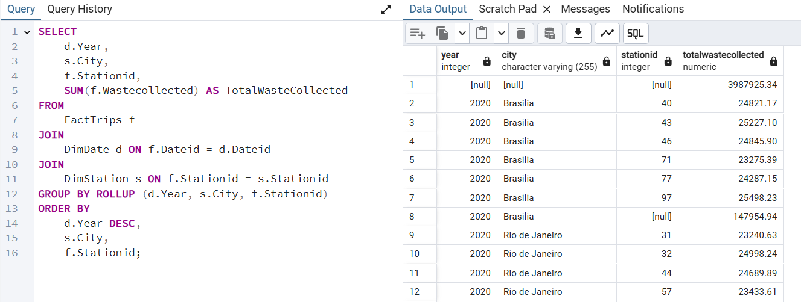

# 🚛 Solid Waste Management Data Warehouse


A **star-schema data warehouse** for a solid waste management company that collects and recycles waste across major cities in Brazil. The project covers dimensional modeling, schema implementation in PostgreSQL, loading 106,400 trip records from CSV, and building analytical reports with **GROUPING SETS**, **ROLLUP**, **CUBE** and a **materialized view**.

> ⚡ **[Enhanced Edition](enhanced/README.md):** the same warehouse rebuilt as a production-style pipeline, with staging and warehouse layers, an automated data-quality gate, idempotent upserts, a fix for a defect found in the source data, and an **Apache Airflow** DAG that refreshes the reports.

---

## 📑 Table of Contents

- [Business Scenario](#-business-scenario)
- [Architecture](#-architecture)
- [Repository Structure](#-repository-structure)
- [Project Tasks](#-project-tasks)
- [Results](#-results)
- [Data Quality Finding](#-data-quality-finding)
- [Enhanced Edition](#-enhanced-edition)
- [How to Run](#-how-to-run)
- [Key Takeaways](#-key-takeaways)
- [Author](#-author)

---

## 🏢 Business Scenario

The company operates hundreds of trucks of different types to collect and transport solid waste. It needs a data warehouse to answer reporting questions such as:

- Total waste collected per **year / quarter / month** per **city**
- Total waste collected per **year** per **truck type**
- Total waste collected per **truck type** per **city**
- Total waste collected per **truck type** per **station** per **city**

The project ran in two phases. The **initial schema** was designed from a sample of trip data (waste type, collection zone, city, date). Because of operational changes, the company then supplied data with a different structure (trucks and stations), and the **final schema** was rebuilt to match it.

---

## 🏗️ Architecture

```
                      ┌────────────────┐
                      │    DimDate     │
                      │    350 days    │
                      └───────┬────────┘
                              │ Dateid
┌────────────────┐    ┌───────┴────────┐    ┌────────────────┐
│    DimTruck    │    │   FactTrips    │    │   DimStation   │
│   71 trucks    ├────┤ 106,400 trips  ├────┤  19 stations   │
│  Volvo/Scania  │    │ Wastecollected │    │    4 cities    │
└────────────────┘    └────────────────┘    └────────────────┘
     key: Truckid                              key: Stationid
```

**Fact:** `FactTrips` holds one row per collection trip, with foreign keys to each dimension and the measure `Wastecollected` (tons, `DECIMAL(10,2)`).

**Dimensions:** `DimDate` (pre-split calendar attributes, including quarter), `DimTruck` (truck type) and `DimStation` (city).

Full ER diagrams for both phases and the reasoning behind each design decision: **[docs/SCHEMA.md](docs/SCHEMA.md)**

---

## 📂 Repository Structure

```
waste-management-data-warehouse/
├── README.md
├── LICENSE
├── data/                              # Source CSV files provided by the company
│   ├── DimDate.csv
│   ├── DimStation.csv
│   ├── DimTruck.csv
│   └── FactTrips.csv
├── sql/
│   ├── phase1-design/
│   │   └── 01_create_initial_schema.sql   # Tasks 1–8: initial star schema
│   └── phase2-implementation/
│       ├── 01_create_tables.sql           # Tasks 9–12: final schema
│       ├── 02_load_data.sql               # CSV load + row-count check
│       ├── 03_grouping_sets.sql           # Task 13
│       ├── 04_rollup.sql                  # Task 14
│       ├── 05_cube.sql                    # Task 15
│       ├── 06_materialized_view.sql       # Task 16
│       └── 07_validation_checks.sql       # Supplementary data checks
├── docs/
│   ├── SCHEMA.md                      # ER diagrams and design decisions
│   ├── TASKS.md                       # Task-by-task walkthrough
│   └── DATA_QUALITY.md                # Validation results and findings
├── screenshots/                       # pgAdmin results
└── enhanced/                          # ⚡ Production-style rebuild
    ├── README.md                      # What changed and why
    ├── run_pipeline.sh                # One-command pipeline runner
    ├── sql/                           # staging → dw → quality gate → reports
    └── airflow/dags/
        └── waste_dw_pipeline.py       # Airflow orchestration
```

---

## ✅ Project Tasks

| # | Task | Phase | Script |
|---|---|---|---|
| 1–4 | Design `MyDimDate`, `MyDimWaste`, `MyDimZone`, `MyFactTrips` | Initial design | [docs/SCHEMA.md](docs/SCHEMA.md#phase-1--initial-design-sample-data) |
| 5–8 | Create the initial tables | Initial design | [01_create_initial_schema.sql](sql/phase1-design/01_create_initial_schema.sql) |
| 9–12 | Create `DimDate`, `DimTruck`, `DimStation`, `FactTrips` in `FinalProject` | Final schema | [01_create_tables.sql](sql/phase2-implementation/01_create_tables.sql) |
| — | Load the CSV files | Final schema | [02_load_data.sql](sql/phase2-implementation/02_load_data.sql) |
| 13 | GROUPING SETS: total waste by station and truck type | Analytics | [03_grouping_sets.sql](sql/phase2-implementation/03_grouping_sets.sql) |
| 14 | ROLLUP: total waste by year, city and station | Analytics | [04_rollup.sql](sql/phase2-implementation/04_rollup.sql) |
| 15 | CUBE: average waste by year, city and station | Analytics | [05_cube.sql](sql/phase2-implementation/05_cube.sql) |
| 16 | Materialized view `max_waste_stats` | Analytics | [06_materialized_view.sql](sql/phase2-implementation/06_materialized_view.sql) |

Detailed walkthrough with explanations and screenshots: **[docs/TASKS.md](docs/TASKS.md)**

---

## 📊 Results

**Data loaded**

| Table | Rows |
|---|---:|
| `DimDate` | 350 |
| `DimTruck` | 71 |
| `DimStation` | 19 |
| `FactTrips` | 106,400 |

**Headline figures** (from the aggregation queries)

| Metric | Value |
|---|---:|
| Total waste collected | **3,987,925.34 tons** |
| Collected by Scania trucks | 2,079,167.04 tons (55,479 trips) |
| Collected by Volvo trucks | 1,908,758.30 tons (50,921 trips) |
| Cities served | Sao Paulo, Salvador, Brasilia, Rio de Janeiro |
| Materialized view `max_waste_stats` | 36 rows (station × truck type) |

**ROLLUP output in pgAdmin** (Year → City → Station, with subtotals)



---

## 🔍 Data Quality Finding

Validation checks confirmed that totals match across all queries and that no trip references a missing dimension row.

They also uncovered an issue in the source file: **every weekday name in `DimDate.csv` is shifted by one day** (for example, 2019-03-09 is labeled *Sunday* but was a *Saturday*). Yearly, monthly and quarterly reports are unaffected, but any weekday-based report would be wrong. The data was loaded unchanged as the course required, and the production fix (deriving weekdays from the date itself) is documented.

Details and queries: **[docs/DATA_QUALITY.md](docs/DATA_QUALITY.md)**

---

## ⚡ Enhanced Edition

The core project follows the course specification. The **[enhanced edition](enhanced/README.md)** rebuilds the same warehouse the way a production pipeline would:

```
CSV ──COPY──▶ staging (raw) ──transform──▶ dw (star schema) ──▶ quality gate ──▶ reports + materialized view
                                                                    │
                                                              FAIL → stop
```

| Improvement | Why it matters |
|---|---|
| `staging` → `dw` layers | Raw input is inspected before it reaches the warehouse |
| Calendar attributes derived from the date | Fixes all 350 shifted weekday names from the source |
| Automated quality gate (6 checks) | A bad load stops the pipeline instead of reaching reports |
| Idempotent upserts in one transaction | Safe to re-run; all tables load or none do |
| `NOT NULL`, `CHECK` constraints, FK indexes | Invalid values are rejected; joins stay fast |
| Labeled subtotals, `NULLS LAST`, rounded averages | Query output reads like a finished report |
| Six business report views | One named view per report the company requested |
| Concurrent materialized view refresh | Dashboards keep reading during a refresh |
| Apache Airflow DAG | Daily load → validate → refresh, with the gate in between |

Same source data, same totals (**3,987,925.34 tons**), verified on PostgreSQL 16.

---

## ▶️ How to Run

**Requirements:** PostgreSQL 13+ (tested on 16) and `psql`, or pgAdmin.

```bash
# 1. Clone the repository
git clone https://github.com/SaBuMa/waste-management-data-warehouse.git
cd waste-management-data-warehouse

# 2. Create the database
psql -U postgres -c "CREATE DATABASE FinalProject;"

# 3. Create the tables and load the data (run from the repo root)
psql -U postgres -d finalproject -f sql/phase2-implementation/01_create_tables.sql
psql -U postgres -d finalproject -f sql/phase2-implementation/02_load_data.sql

# 4. Run the analytical queries
psql -U postgres -d finalproject -f sql/phase2-implementation/03_grouping_sets.sql
psql -U postgres -d finalproject -f sql/phase2-implementation/04_rollup.sql
psql -U postgres -d finalproject -f sql/phase2-implementation/05_cube.sql
psql -U postgres -d finalproject -f sql/phase2-implementation/06_materialized_view.sql

# 5. (Optional) Validation checks
psql -U postgres -d finalproject -f sql/phase2-implementation/07_validation_checks.sql
```

**Using pgAdmin instead:** create the `FinalProject` database, run `01_create_tables.sql` in the Query Tool, and import each CSV with *Import/Export Data* (Format: csv, Header: on, Delimiter: `,`), loading the dimensions before `FactTrips`.

---

## 💡 Key Takeaways

- **Measures go in the fact table, descriptions go in dimensions.** A simple test for any column: would you SUM it or GROUP BY it?
- **Foreign keys turn bad data into loud errors.** Trips pointing to a missing station or truck are rejected at load time instead of silently skewing reports.
- **Choose the right aggregation operator:**
  - `GROUPING SETS`: you pick the exact combinations.
  - `ROLLUP`: a hierarchy, dropping columns right to left (n + 1 groupings).
  - `CUBE`: every combination (2ⁿ groupings).
- **`NULL` in a subtotal row means "all".** Grand totals that match the raw fact table confirm the joins are correct.
- **Materialized views trade freshness for speed.** Results are stored and must be refreshed after each data load.
- **Production pipelines need more than correct SQL:** layers, idempotency, automated validation and orchestration (see the [enhanced edition](enhanced/README.md)).
- **Validate source data instead of trusting it.** Derived attributes like weekday should be computed from the date, not copied from upstream files.

---

## 👤 Author

**Santiago Burgos**
Electronics Engineer transitioning into Data Engineering

[](https://github.com/SaBuMa)
[](https://www.linkedin.com/in/santiagoburgosm)

---

*This project was completed as part of the IBM Data Engineering Professional Certificate. The dataset is provided by IBM Skills Network for educational purposes.*
