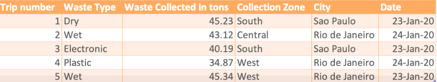
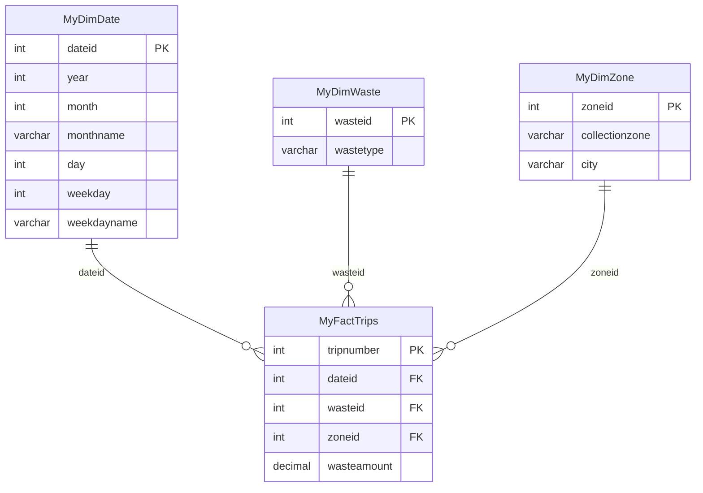
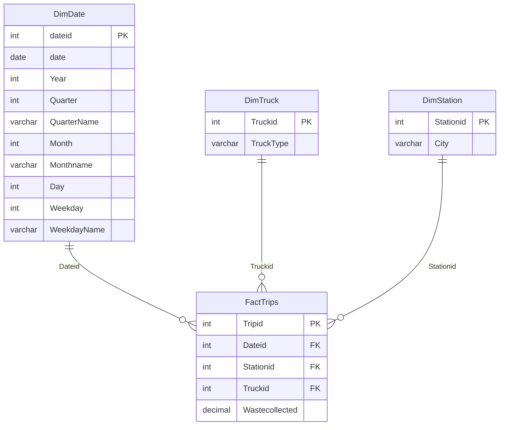

# 🧩 Schema Design

This document explains how the warehouse was modeled, why each design decision was made, and how the schema changed between the two project phases.

---

## Design principle: SUM it or GROUP BY it?

Every column in a star schema answers one question:

| If you would… | It is a… | It lives in… |
|---|---|---|
| **SUM / AVG / MAX** it | Measure | the **fact** table |
| **GROUP BY / filter** on it | Attribute | a **dimension** table (only its key is stored in the fact) |

A useful analogy is a **supermarket receipt**: each line prints a *product code* and the *amount paid*, not the full product description. The descriptions live in a catalog you look up. The fact table is the receipt; the dimensions are the catalogs.

---

## Phase 1 — Initial design (sample data)

The company's first sample had: trip number, waste type, tons collected, collection zone, city and date.

**Key decisions**

- **`wasteamount` is in the fact table, not in `MyDimWaste`.** It changes with every trip, so it is a measure. `MyDimWaste` holds only the four waste types.
- **Zone and city live together in `MyDimZone`.** "South" appears in both Sao Paulo and Rio de Janeiro, so a zone only identifies a place when paired with its city.
- **The fact table stores keys, not text.** Repeating "Rio de Janeiro" in every trip row wastes space and invites inconsistencies.
- **`DECIMAL(10,2)` for tonnage.** Values like `45.23` would be silently rounded by `INT`.

---

## Phase 2 — Final design (data actually collected)

Due to operational changes, the company could no longer collect waste type and zone. Instead, it provided **truck** and **station** data, which the original business reports already required ("per truck type", "per station").

| Table | Rows | Grain |
|---|---:|---|
| `DimDate` | 350 | one row per day (2019-03-09 → 2020-02-21) |
| `DimTruck` | 71 | one row per truck (Volvo / Scania) |
| `DimStation` | 19 | one row per collection station (4 cities) |
| `FactTrips` | 106,400 | one row per collection trip |

**Key decisions**

- **Column names and order follow the CSV files exactly**, so the files load without transformation.
- **Foreign keys on every fact column that points to a dimension.** A trip with an unknown station or truck is rejected at load time instead of silently corrupting reports.
- **Dimensions are created and loaded before the fact table**, because the fact table references them.
- **Unquoted identifiers.** PostgreSQL folds them to lowercase (`DimDate` → `dimdate`), so queries work in any case without quoting.

---

## How the business reports map to the schema

| Business report | Measure | Dimensions used |
|---|---|---|
| Total waste per year / quarter / month per city | `SUM(Wastecollected)` | `DimDate`, `DimStation` |
| Total waste per year per truck type | `SUM(Wastecollected)` | `DimDate`, `DimTruck` |
| Total waste per truck type per city | `SUM(Wastecollected)` | `DimTruck`, `DimStation` |
| Total waste per truck type per station per city | `SUM(Wastecollected)` | `DimTruck`, `DimStation` |
