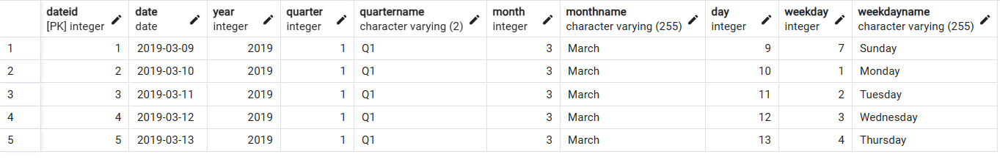
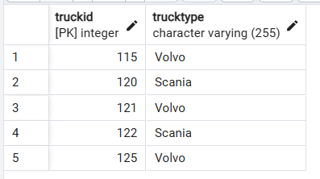
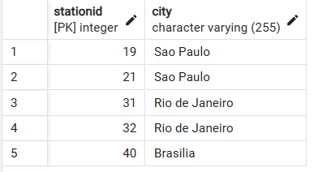
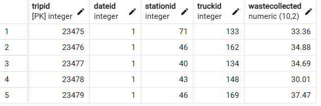
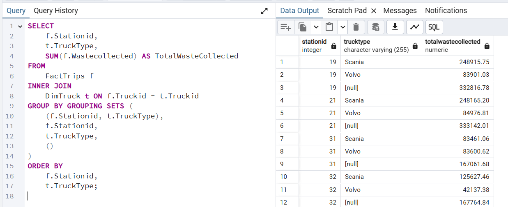
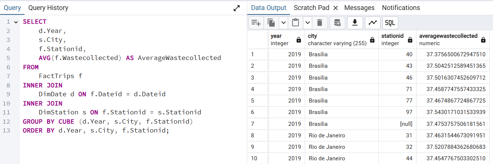
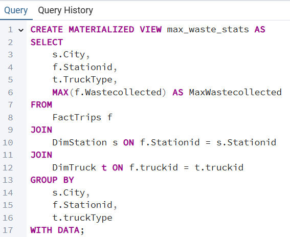

# 📋 Task Walkthrough

Step-by-step record of the 16 project tasks: what each one asked for, how it was solved, and what the result showed.

---

## Phase 1 — Design and create the initial schema (Tasks 1–8)

| # | Task | Solution |
|---|---|---|
| 1 | Design `MyDimDate` (day granularity: year, month, day, weekday) | `dateid, year, month, monthname, day, weekday, weekdayname` |
| 2 | Design `MyDimWaste` | `wasteid, wastetype` (tonnage moved to the fact table) |
| 3 | Design `MyDimZone` | `zoneid, collectionzone, city` |
| 4 | Design `MyFactTrips` | `tripnumber, dateid, wasteid, zoneid, wasteamount` |
| 5–8 | Create the four tables | [`01_create_initial_schema.sql`](../sql/phase1-design/01_create_initial_schema.sql) |

**Design review highlights**

- The first draft placed `wasteamount` inside `MyDimWaste`. Since it varies per trip, it was moved to the fact table as the measure.
- The first draft stored `collectionzone` and `cityname` as text in the fact table. They were replaced by a single `zoneid` foreign key.
- `wasteamount INT` was changed to `DECIMAL(10,2)`, because the sample data has two decimals (e.g. `45.23`).

---

## Phase 2 — Implement the final schema (Tasks 9–12)

The company changed the data it could collect and provided four CSV files. A new database, **`FinalProject`**, was created in pgAdmin, and the tables were defined from the CSV headers.

| # | Task | Script |
|---|---|---|
| 9 | Create `DimDate` | [`01_create_tables.sql`](../sql/phase2-implementation/01_create_tables.sql) |
| 10 | Create `DimTruck` | same |
| 11 | Create `DimStation` | same |
| 12 | Create `FactTrips` (with foreign keys) | same |
| — | Load the CSV files | [`02_load_data.sql`](../sql/phase2-implementation/02_load_data.sql) |

Loading was done with pgAdmin's **Import/Export** tool (CSV, header on, comma delimiter). The script contains the equivalent `\copy` commands for psql.

**Loaded row counts:** `DimDate` 350 · `DimTruck` 71 · `DimStation` 19 · `FactTrips` 106,400

| DimDate | DimTruck | DimStation | FactTrips |
|---|---|---|---|
|  |  |  |  |

---

## Phase 3 — Aggregation queries and materialized view (Tasks 13–16)

### Task 13 — GROUPING SETS

*Total waste collected by station and truck type.* → [`03_grouping_sets.sql`](../sql/phase2-implementation/03_grouping_sets.sql)

`GROUPING SETS` stacks several `GROUP BY` reports into one result. In each row, a `NULL` key means "all of them".

| Stationid | TruckType | TotalWasteCollected | Row type |
|---:|---|---:|---|
| 19 | Scania | 248,915.75 | station × truck type |
| 19 | Volvo | 83,901.03 | station × truck type |
| 19 | *(all)* | 332,816.78 | station subtotal |
| *(all)* | Scania | 2,079,167.04 | truck-type subtotal |
| *(all)* | Volvo | 1,908,758.30 | truck-type subtotal |
| *(all)* | *(all)* | **3,987,925.34** | grand total |

*Excerpt of the 58-row result.*



### Task 14 — ROLLUP

*Total waste collected by year, city and station.* → [`04_rollup.sql`](../sql/phase2-implementation/04_rollup.sql)

`ROLLUP` follows a hierarchy and removes columns from right to left:

```
(Year, City, Station) → (Year, City) → (Year) → () grand total
```

Column order matters: a station belongs to one city, and a year contains all cities. Because of `ORDER BY Year DESC`, PostgreSQL places the NULL (grand total) row first.


### Task 15 — CUBE

*Average waste collected by year, city and station.* → [`05_cube.sql`](../sql/phase2-implementation/05_cube.sql)

`CUBE` produces every combination of the three columns (2³ = 8 groupings). Each subtotal average is computed from the raw trips rather than by averaging averages, so stations with more trips carry more weight.



### Task 16 — Materialized view

*Create `max_waste_stats` with city, station, truck type and max waste collected.* → [`06_materialized_view.sql`](../sql/phase2-implementation/06_materialized_view.sql)

A materialized view stores the query result like a table: reads are instant, and the data is refreshed on demand with `REFRESH MATERIALIZED VIEW max_waste_stats;`. The view returns **36 rows** (station × truck type combinations).



---

## Pitfalls caught during validation

| Pitfall | Why it matters | Fix |
|---|---|---|
| Joining `Tripid` to `Stationid` | No error, just an **empty result** | Join on the matching key (`f.Stationid = s.Stationid`) |
| Grouping by `Truckid` instead of `TruckType` | One row per truck (71) instead of per type (2), and NULL types in detail rows | GROUP BY exactly the columns you SELECT |
| `INT` for tonnage | Silent rounding of every value | `DECIMAL(10,2)` |
| Leftover template names (`FactSales`, `Productid`) | Query fails on missing objects | Search for old-domain names after adapting a template |
